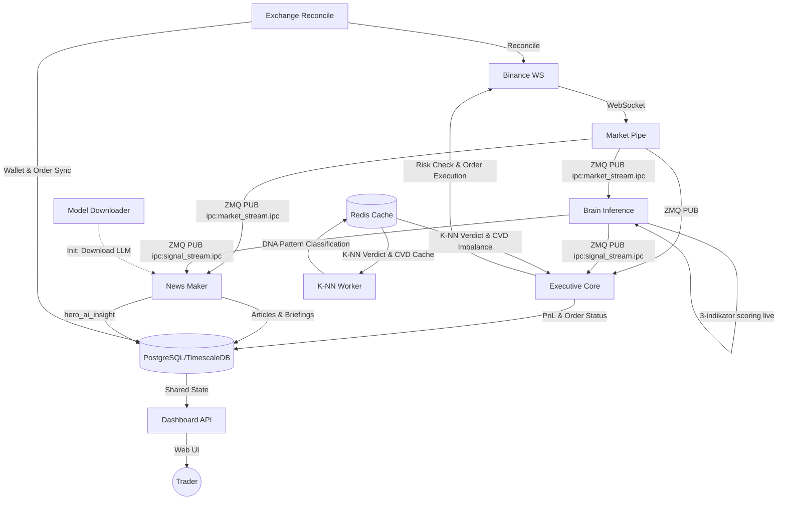

# Algovibe 🌊🤖

**Algovibe** adalah bot trading kripto otomatis (Scalping HFT) untuk platform **Binance Spot** dan **Indodax** yang menggunakan arsitektur **Microservices** berbasis event-driven. Bot ini menggabungkan kecepatan eksekusi algoritma kuantitatif dengan analisis berbasis indikator teknikal murni untuk navigasi market yang presisi pada timeframe 1 menit (1m).

---

## 🎯 Fitur Utama

- **Microservice Architecture:** Terbagi menjadi layanan independen (`market-pipe`, `brain-inference`, `knn-worker`, `executive-core`, `exchange-reconcile`, `dashboard-api`, `news-maker`) yang berjalan dalam container Docker terisolasi untuk skalabilitas dan stabilitas tinggi.
- **TECHNICAL_ONLY_MODE:** Semua keputusan trading 100% berbasis indikator teknikal murni untuk performa maksimal dan zero latency. LLM (`litert-lm-decision`) dinonaktifkan dan hanya digunakan untuk penulisan artikel pasar otomatis via `news-maker`.
- **Live Market Data:** Semua scoring dan sinyal menggunakan in-memory price history dari WebSocket stream — bukan data database yang rentan stale.
- **Market Regime Detection:** Oracle sentral mendeteksi fase market secara global (Bullish, Bearish, Choppy, Ranging, Crash) dan menyesuaikan strategi secara dinamis.
- **ZMQ-Driven Data Bus:** Komunikasi antar-layanan menggunakan ZeroMQ (IPC) untuk latency minimal (sub-milidetik). Redis digunakan untuk K-NN verdict dan CVD imbalance cache O(1).
- **Binance Spot Ready:** Kalkulasi PnL akurat yang memperhitungkan fee round-trip exchange secara tepat.
- **Interactive Dashboard:** Monitoring realtime via Vue.js & SocketIO dengan visualisasi radar market dan eksekusi manual.
- **K-NN Worker:** Background service yang mengklasifikasikan pola DNA harga historis ke dalam Redis secara real-time.
- **Dedicated Exchange Reconcile:** Service terpisah (`exchange-reconcile`) yang secara berkala menyelaraskan state bot dengan kondisi wallet dan order aktual di exchange.
- **Multi-Tier Capital Protection:** Sistem berlapis — Basket Harvest, Momentum Equity Protection, Net-Zero Survival Guard — melindungi modal dari drawdown beruntun.
- **Dynamic TP/SL/Profit Scaling:** Target TP, SL, dan minimum profit menyesuaikan otomatis dengan pertumbuhan modal (2.0%–3.5% TP).
- **Session Awareness Engine:** Evaluator kondisi bot terpadu yang mengklasifikasikan sesi trading ke dalam 7 state strategi (`HALT` → `RECOVERY_CRISIS` → `RECOVERY_DAILY` → `RECOVERY_ALLTIME` → `CAUTIOUS` → `NORMAL` → `MOMENTUM_CHASE`). Setiap state mendefinisikan threshold teknikal, ukuran posisi, dan batas pair secara otomatis sesuai kondisi PnL dan regime market.
- **Automated News Engine:** News Maker menghasilkan artikel analisis pasar otomatis (Morning Briefing, Trending Review, Evening Review, Breaking Headlines) dengan dukungan LLM lokal maupun cloud provider.

---

## 🔄 Workflow Arsitektur (Microservices)



---

## 🧠 Cara Kerja (Technical Engine - v3.0)

Algovibe menggunakan sistem **HFT Momentum Breakout Confluence** dengan 3 indikator utama berkecepatan tinggi:

| # | Indikator | Bobot | Catatan / Kondisi |
|---|-----------|-------|-------------------|
| 1 | **Price Velocity** | 3.5 | Kenaikan/penurunan harga cepat 4-periode; >0.4% = skor penuh (+3.5), >0.15% = skor sedang (+1.5) |
| 2 | **Volume Ratio** | 3.5 | Volume saat ini dibanding MA-20; >=2.0x = skor penuh (+3.5), >=1.4x = skor sedang (+1.5) |
| 3 | **Order Book Pressure** | 3.0 | Rasio Bid/Ask depth volume; >=65% Bid = skor penuh (+3.0), >=55% Bid = skor sedang (+1.5) |

*   **Syarat BUY:** `total_score >= 6.5` (Max score: 10.0).
*   **Syarat SELL Block:** `sell_score >= 7.0` (Mencegah entry jika tekanan jual tinggi).

### ⚡ Entry Gate Sequence (`entry_gates.py`)

Gerbang dievaluasi secara **Asinkron** untuk menghemat CPU dan menurunkan latensi:
*   **State Monitors (Berat):** Dihitung hanya 1x per menit saat kline ditutup dan disimpan di memori (EMA-50, ATR, MTFA, Cooldown, Consecutive Losses).
*   **Trigger Monitors (Ringan):** Dievaluasi instan pada setiap tick 1s (RSI, Velocity, CVD Imbalance, K-NN Verdict dari Redis).

1.  **Open position / blacklist guard**
2.  **Cooldown guard**
3.  **Radar recommendation + tracking log**
4.  **Multi-confluence technical gate** (SELL block jika `sell_score >= 5.0`)
    *   **ATR Volatility Filter (4b):** Reject jika ATR > 3% harga (4.5% di loose gates).
    *   **EMA-50 Trend Filter (4c):** Reject jika harga < EMA-50.
        *   *Bottom-Explosion Exception:* Bypass filter EMA jika deteksi Mean Reversion ekstrim: `RSI < 26` + `Buy Pressure > 66%` + `Volume Ratio > 2.1`.
    *   **MTFA Alignment (Multi-Timeframe):** Harga harus berada di atas EMA-50 pada timeframe 5m dan 15m (approx dari history 1m).
5.  **Technical probability & CVD imbalance threshold** (Mengambil data imbalance real-time dari Redis).
6.  **Trend / breakout requirement**
7.  **Radar recommendation guard**
8.  **Dynamic threshold based on volatility + trend**
9.  **Consecutive-loss halt / Shadow Recovery**
10. **K-NN Isolated pattern scoring** (Mengambil keputusan pola dari Redis dengan fallback synchronous).
11. **Final confidence threshold**
12. **5s Wick Delay & Retrace Abort Guard:** Menunda eksekusi order selama 5 detik pada lonjakan momentum (`velocity > 0.3%`), membatalkan order jika harga memantul turun (retracement $> 30\%$) dari puncak breakout.

---

## 🧭 Session Awareness Engine (`session_awareness.py`)

Evaluator kondisi bot terpadu yang berjalan setiap siklus scan. Mengklasifikasikan sesi ke dalam **7 state strategi** secara otomatis berdasarkan PnL harian, PnL all-time, regime market, dan consecutive losses. Setiap state meng-inject parameter risiko langsung ke `brain-inference` dan `pair-pipeline`.

| State | Ukuran Posisi | Max Pair | Score Threshold | Kondisi Trigger |
|---|---|---|---|---|
| `HALT` | 0% | 0 | — | Consecutive losses mencapai batas maksimum |
| `RECOVERY_CRISIS` | 25% | 1 | 8.0 | All-time loss > 3× daily limit (~$90) |
| `RECOVERY_DAILY` | 40% | 1 | 7.5 | Daily loss limit terpenuhi |
| `RECOVERY_ALLTIME` | 65% | 2 | 7.0 | All-time PnL negatif |
| `CAUTIOUS` | 80% | 3 | 6.8 | Regime BEARISH/CHOPPY atau daily loss > 50% |
| `NORMAL` | 100% | 5 | 6.5 | Kondisi default |
| `MOMENTUM_CHASE` | 115% | 6 | 6.2 | Regime BULLISH + sesi profitable |

*   State disimpan ke `bot_state` (PostgreSQL) dan dipublikasikan ke Redis (TTL 30s) untuk konsumsi lintas service.
*   Dashboard menampilkan **badge warna** real-time sesuai severity state (hijau → merah berkedip untuk HALT).
*   Transisi ke state kritis (`HALT`, `RECOVERY_CRISIS`, `RECOVERY_DAILY`) mengirimkan notifikasi Telegram otomatis.

---

## 🛡️ Exit Strategy & Profit Protection Suite (`exit_manager.py`)

Untuk mencegah erosi keuntungan akibat whipsaw pada timeframe 1m, Exit Manager menerapkan pengamanan berlapis secara dinamis:

*   **TTP Target Floor Lock (Anti Profit Erosion):** Jika puncak harga melampaui target Take Profit (`tp_price`), batas trailing stop otomatis **dikunci minimal setara `tp_price`**. Posisi dijamin tidak akan keluar di bawah profit target awal meskipun harga berbalik arah.
*   **Dynamic Breakeven & Hyper-Tight Trailing SL:**
    *   Menggeser Stop Loss (SL) ke level breakeven (+ 0.02% cushion biaya transaksi) segera setelah profit mencapai $\ge +0.3\%$ gross.
    *   Menggeser SL ke trailing stop ketat **0.2% dari puncak harga** jika profit mencapai $\ge +0.5\%$ dan posisi telah berjalan $\ge 2$ menit (Slow Trade).
*   **Momentum Fading Profit Lock (Exit Pasar Agresif):** Jika posisi sudah net-profit ($\ge +0.3\%$ gross) dan durasi posisi mencapai $\ge 2$ menit, bot akan langsung mengeksekusi **Market Sell** jika momentum melemah (verdict != `BUY`, atau sinyal `SELL`, atau keyakinan/confidence < 0.40).
*   **Micro Profit Exit:** Evaluasi exit pada harga `bid` riil (bukan harga terakhir `last`) untuk memastikan profit bersih aman setelah dipotong spread pasar. Auto-aktif jika balance di bawah threshold (`MICRO_PROFIT_BALANCE_THRESHOLD`).
*   **Dynamic TP/SL/Min-Profit Tiers:** Target TP dan minimum profit bersih menyesuaikan otomatis dengan saldo aktif:
    *   Balance ≤ $100: TP 2.0%, min profit 0.01%
    *   Balance $100–$250: TP 2.2%, min profit 0.05%
    *   Balance $250–$1000: TP 2.5%, min profit 0.1%
    *   Balance > $1000: TP 3.5%, min profit 0.2%

### 💰 Basket Harvest & Portfolio Protection

*   **Basket Harvest (Guaranteed Profit Harvester):** Trigger close semua posisi secara bersamaan ketika combined net PnL mencapai ~5% modal (min $20 USDT), bahkan jika semua posisi masih profit.
*   **HWM Pullback Trigger:** Jika combined PnL turun > 30% dari peak session, eksekusi basket exit otomatis.
*   **BTC Crash Kill Switch:** Drop BTC > 2% dalam 5 menit memicu emergency basket exit tanpa menunggu gate profit.
*   **HARVEST_ONLY Selective Re-entry:** Setelah harvest tercapai, bot hanya mengizinkan 1 posisi baru dengan kriteria sangat ketat (confidence ≥ 78–82%, tq_prob ≥ 0.68–0.72).

### 🛑 Net-Zero Survival Guard

Guard darurat yang mencegah sesi trading berakhir rugi parah akibat correlated drawdown:
*   Aktif saat PnL portfolio jatuh di bawah floor ($-15\%$ modal, min −$15) DAN velocity PnL < $-0.5$ USDT/detik.
*   Memiliki hysteresis 3 detik untuk mencegah false trigger. Bypass langsung jika velocity < $-1.2$ USDT/detik (collapse).
*   Auto-reset setelah 10 detik jika PnL pulih di atas floor.

---

## 🧪 Backtesting Engine (High-Fidelity)

Algovibe dilengkapi dengan mesin backtesting performa tinggi untuk memvalidasi strategi secara kuantitatif sebelum dijalankan di live market.

### Fitur Utama Backtester:
- **High-Performance NumPy Engine:** Menggunakan simulasi berbasis array (vektor) untuk memproses ribuan candle dalam hitungan detik.
- **1:1 Strategy Parity:** Menggunakan fungsi teknikal dan gerbang filter (`entry_gates.py`) yang persis sama dengan bot live.
- **High-Fidelity Simulation:**
    - **Slippage & Spread Simulation:** Mensimulasikan harga eksekusi di *bid/ask* spread untuk estimasi profit yang realistis.
    - **Portfolio Layer:** Mensimulasikan batasan modal riil dengan parameter `max_open_positions` global lintas pair.
- **Advanced Quantitative Metrics:** Sortino Ratio, Recovery Factor, Calmar Ratio, Kelly Criterion, dan Expectancy.

### Operasional Backtest:

```bash
# 1. Fetch data historis (default 90 hari terakhir)
docker compose run --rm backtester fetch

# 2. Jalankan backtest untuk semua profil aktif
docker compose run --rm backtester run

# 3. Jalankan backtest dengan filter pair tertentu
docker compose run --rm backtester run --days 30 --pairs BTC-USDT,ETH-USDT

# 4. Lihat laporan ringkasan terakhir
docker compose run --rm backtester report

# 5. Rekursif Optimasi (Auto-Tuning) — Loop 5 generasi
docker compose run --rm backtester optimize --generations 5
```

---

## ⚙️ Arsitektur Proyek

```
services/
├── market_pipe/        # Ingress: Exchange WS -> ZMQ Protobuf (latency ultra-rendah)
├── brain_inference/    # Scoring & Oracle: live in-memory history, 3 indikator v3.0
├── executive_core/     # Execution: Risk Checks, P&L, Order Placement, Exit Manager
├── exchange_reconcile/ # Reconcile: sinkronisasi wallet & order state dari exchange ke DB
├── knn_worker/         # K-NN Worker: Standardisasi DNA & pre-scoring ke Redis
├── news_maker/         # Automated Editorial Engine: briefings, headlines, trending review
├── backtester/         # On-demand: fetch OHLCV, run backtest, optimize strategy
└── litert_lm_decision/ # LLM service (DINONAKTIFKAN — trading path di-guard TECHNICAL_ONLY_MODE)
app/
├── application/
│   ├── entry_gates.py          # Asynchronous Entry Gates, MTFA, Wick Delay
│   ├── session_awareness.py    # 7-state strategy ladder: HALT → MOMENTUM_CHASE; injects risk params ke brain-inference & pair-pipeline
│   ├── use_cases/
│   │   ├── trade_execution.py  # BUY execution, fee-trap pure-% guard
│   │   └── candidate_enrichment.py
│   ├── oracle.py               # Market regime & K-NN pattern scoring
│   └── exit_manager.py         # TP/SL/Trailing, Dynamic Breakeven, Basket Harvest, Net-Zero Guard
├── domain/
│   ├── technicals.py   # 3 indikator v3.0 (Velocity, Volume Ratio, OB Pressure) + 15 helper indicators
│   ├── scoring.py      # Radar scoring; terima price_history (live) sebagai arg ke-4
│   └── predictor.py    # ML model inference (Scalper V2)
└── infrastructure/
    ├── database.py     # PostgreSQL/TimescaleDB connector
    ├── ws_market.py    # WebSocket market stream + in-memory ticker/OB cache
    ├── volume_tracker.py # Real-time CVD sliding volume tracker (aggTrades)
    └── auto_trainer.py # Loop self-training model
```

---

## 🚀 Cara Menjalankan

### Orchestrator (Rekomendasi - Host-side)

```bash
# 1. Setup Environment
cp .env-example .env
nano .env  # Isi EXCHANGE (binance/indodax) dan API Credentials

# 2. Jalankan Instalasi & Build Otomatis (Host)
chmod +x install.sh
./install.sh --prod  # Atau --dev untuk Development
```

### Operasional Kontainer - Development (Docker Compose)

```bash
# Menyalakan stack microservices secara background (dev mode dengan host mount)
docker compose up -d

# Restart layanan tertentu setelah perubahan kode
docker compose restart executive-core dashboard-api

# Melihat live logs untuk memantau trading
docker compose logs -f executive-core market-pipe
```

### Operasional Kontainer - Production (Host-Mount-Free)

Untuk deployment di server production, **sangat direkomendasikan** menggunakan `docker-compose-prod.yml` yang beroperasi **100% tanpa mounting host**. Seluruh kode aplikasi dan skema database dibake langsung ke dalam Docker image untuk menjamin isolasi, keamanan, portabilitas tinggi, dan performa optimal.

#### 1. Keunggulan Arsitektur Produksi:
* **Image Aplikasi**: Dibuild langsung ke target image `algovibe-binance:latest` (menggunakan `Dockerfile`).
* **Image Database**: Menggunakan image kustom `algovibe-timescaledb:latest` (menggunakan `Dockerfile.db`) yang menyertakan script inisialisasi skema database tanpa mounting.
* **Storage & RAM IPC**: Menggunakan Docker Named Volumes dan RAM-disk (`tmpfs` volume `algovibe_ipc` sebesar 64MB) untuk komunikasi latensi ultra-rendah antar kontainer.
* **Resource Priority**: Service `executive-core` diberikan CPU shares tinggi (`cpu_shares: 2048`) untuk mengutamakan eksekusi order exit penting.
* **Model Downloader**: Init service `model-downloader` men-download model AI (~2.5 GB) ke named volume satu kali. Jika model sudah ada dan valid, service langsung exit.
* **Redis**: Cache service (`algovibe-redis`) untuk K-NN verdict dan CVD imbalance — digunakan oleh `knn-worker`, `executive-core`, dan `entry_gates`.

#### 2. Proses Build Image Production:

Proses build pada spesifikasi production ini memanfaatkan arsitektur build yang sangat bersih dan teroptimasi:

*   **Image Aplikasi (`Dockerfile`) - Multi-Stage Build**:
    *   **Stage 1 (Frontend Builder)**: Menggunakan Node.js (`node:20-slim`) untuk mengompilasi kode sumber Dashboard SPA (Vue.js) yang berlokasi di `dashboard/frontend` menjadi berkas static web siap saji di `/app/dashboard/static/dist`.
    *   **Stage 2 (Python Runtime)**: Berbasis `python:3.12-slim` dengan zona waktu Jakarta (`Asia/Jakarta`). Menginstal dependensi Python dari `requirements.txt`, menyalin aset Dashboard terkompilasi dari Stage 1, serta menyalin seluruh modul kode aplikasi. Dibuat user non-root aman `algovibe` untuk eksekusi container. Target tag: `algovibe-binance:latest`.
*   **Image Database (`Dockerfile.db`)**:
    *   Berbasis `timescale/timescaledb:latest-pg15` yang secara otomatis menyalin `init-pg.sh` ke `/docker-entrypoint-initdb.d/init-pg.sh` dan memberikan izin eksekusi. Target tag: `algovibe-timescaledb:latest`.

#### 3. Perintah Operasional:

##### A. Build Image Manual (Menggunakan Native Docker CLI):
Jika Anda ingin membangun image satu per satu secara terpisah (misalnya untuk kebutuhan CI/CD pipeline):
```bash
# Build image aplikasi utama terkompilasi (algovibe-binance:latest)
docker build -t algovibe-binance:latest -f Dockerfile.prod .

# Build image database kustom (algovibe-timescaledb:latest)
docker build -t algovibe-timescaledb:latest -f Dockerfile.db .
```

##### B. Build Image Menggunakan Docker Compose (Direkomendasikan):
```bash
# Build semua image kustom production secara otomatis (Aplikasi + DB)
docker compose -f docker-compose-prod.yml build

# Alternatif: Build salah satu service secara spesifik jika diinginkan
docker compose -f docker-compose-prod.yml build market-pipe   # Mem-build image aplikasi utama
docker compose -f docker-compose-prod.yml build timescaledb   # Mem-build image database TimescaleDB
```

##### C. Manajemen Kontainer & Deployment:
```bash
# 1. Buat network external reverse proxy jika menggunakan Nginx Proxy Manager (NPM)
docker network create npm_default

# 2. Jalankan seluruh stack microservices production secara background
docker compose -f docker-compose-prod.yml up -d

# 3. Memantau logs kontainer production
docker compose -f docker-compose-prod.yml logs -f executive-core dashboard-api

# 4. Menghentikan stack production
docker compose -f docker-compose-prod.yml down
```

---

## 📰 News Maker (Automated Editorial Engine)

`services/news_maker/` menghasilkan artikel pasar kripto otomatis dalam Bahasa Indonesia berdasarkan data live WebSocket stream dan sinyal teknikal.

### LLM Provider:
Mendukung tiga mode provider yang dikonfigurasi via env var `NEWS_LLM_PROVIDER`:
*   `local` (default): Menggunakan model Gemma 4 E2B (`gemma-4-E2B-it.litertlm`) yang di-download oleh `model-downloader`.
*   `huggingface`: Menggunakan Hugging Face Inference API (`NEWS_HF_API_URL`, `NEWS_HF_API_TOKEN`).
*   `cloudflare`: Menggunakan Cloudflare Workers AI (`NEWS_CF_API_URL`, `NEWS_CF_API_TOKEN`).

### Jadwal Otomatis:
*   **08:00 WIB** $\rightarrow$ Morning Briefing (`MORNING_BRIEF`).
*   **14:00 WIB** $\rightarrow$ Daily Trending Review (`TRENDING_REVIEW`).
*   **20:00 WIB** $\rightarrow$ Evening Market Review (`EVENING_REVIEW`).
*   **Realtime** $\rightarrow$ Breaking Headlines jika koin bergerak $>3\%$ dalam 1 jam, atau sinyal `BUY/SELL` dengan keyakinan $\ge 75\%$.

### Generate Manual:
```bash
./generate_news.sh morning
./generate_news.sh evening
./generate_news.sh headline BTC
```

---

## ⚠️ Disclaimer

Software ini dibuat untuk tujuan edukasi dan eksperimen. **Gunakan dengan risiko Anda sendiri.** Pembuat tidak bertanggung jawab atas kerugian finansial. Selalu gunakan **DRY RUN** sebelum masuk ke live market.
