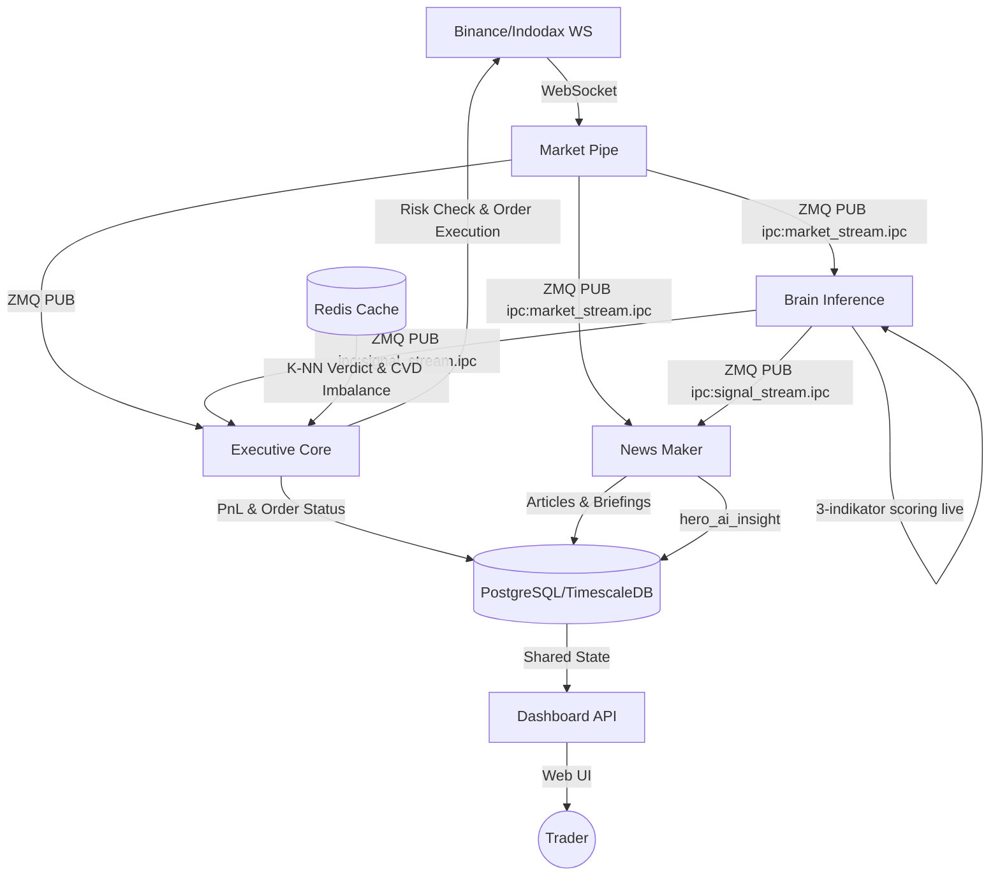

# Algovibe 🌊🤖

**Algovibe** adalah bot trading kripto otomatis (Scalping HFT) untuk platform **Binance Spot** dan **Indodax** yang menggunakan arsitektur **Microservices** berbasis event-driven. Bot ini menggabungkan kecepatan eksekusi algoritma kuantitatif dengan analisis berbasis indikator teknikal murni untuk navigasi market yang presisi pada timeframe 1 menit (1m).

---

## 🎯 Fitur Utama

- **Microservice Architecture:** Terbagi menjadi layanan independen (`market-pipe`, `brain-inference`, `knn-worker`, `executive-core`, `dashboard-api`, `news-maker`) yang berjalan dalam container Docker terisolasi untuk skalabilitas dan stabilitas tinggi.
- **TECHNICAL_ONLY_MODE:** Semua keputusan trading 100% berbasis indikator teknikal murni untuk performa maksimal dan zero latency. LLM hanya digunakan untuk penulisan artikel pasar otomatis.
- **Live Market Data:** Semua scoring dan sinyal menggunakan in-memory price history dari WebSocket stream — bukan data database yang rentan stale.
- **Market Regime Detection:** Oracle sentral mendeteksi fase market secara global (Bullish, Bearish, Choppy, Ranging, Crash) dan menyesuaikan strategi secara dinamis.
- **ZMQ-Driven Data Bus:** Komunikasi antar-layanan menggunakan ZeroMQ (IPC) untuk latency minimal (sub-milidetik).
- **Indodax Tax Compliant & Binance Spot Ready:** Kalkulasi PnL akurat yang memperhitungkan fee round-trip exchange secara tepat.
- **Interactive Dashboard:** Monitoring realtime via Vue.js & SocketIO dengan visualisasi radar market dan eksekusi manual.
- **RF Auto-Trainer & K-NN Worker:** Background service yang melatih ulang model dan mengklasifikasikan pola DNA harga historis ke dalam Redis secara real-time.
- **Automated News Engine:** News Maker menghasilkan artikel analisis pasar otomatis (Morning Briefing, Trending Review, Evening Review, Breaking Headlines) berdasarkan sinyal teknikal live.

---

## 🔄 Workflow Arsitektur (Microservices)



---

## 🧠 Cara Kerja (Technical Engine - v3.0)

Algovibe menggunakan sistem **HFT Momentum Breakout Confluence** dengan 3 indikator utama berkecepatan tinggi:

| # | Indikator | Bobot | Catatan / Kondisi |
|---|-----------|-------|-------------------|
| 1 | **Price Velocity** | 3.5 | Kenaikan/penurunan harga cepat 4-periode; >0.4% = skor penuh (+3.5), >0.15% = skor sedang (+1.5) |
| 2 | **Volume Ratio** | 3.5 | Volume saat ini dibanding MA-20; >=2.0x = skor penuh (+3.5), >=1.4x = skor sedang (+1.5) |
| 3 | **Order Book Pressure** | 3.0 | Rasio Bid/Ask depth volume; >=65% Bid = skor penuh (+3.0), >=55% Bid = skor sedang (+1.5) |

*   **Syarat BUY:** `total_score >= 6.5` (Max score: 10.0).
*   **Syarat SELL Block:** `sell_score >= 7.0` (Mencegah entry jika tekanan jual tinggi).

### ⚡ Entry Gate Sequence (`entry_gates.py`)

Gerbang dievaluasi secara **Asinkron** untuk menghemat CPU dan menurunkan latensi:
*   **State Monitors (Berat):** Dihitung hanya 1x per menit saat kline ditutup dan disimpan di memori (EMA-50, ATR, Cooldown, Consecutive Losses).
*   **Trigger Monitors (Ringan):** Dievaluasi instan pada setiap tick 1s (RSI, Velocity, CVD Imbalance, K-NN Verdict dari Redis).

1.  **Open position / blacklist guard**
2.  **Cooldown guard**
3.  **Radar recommendation + tracking log**
4.  **Multi-confluence technical gate** (SELL block jika `sell_score >= 5.0`)
    *   **ATR Volatility Filter (4b):** Reject jika ATR > 3% harga (4.5% di loose gates).
    *   **EMA-50 Trend Filter (4c):** Reject jika harga < EMA-50.
        *   *Bottom-Explosion Exception:* Bypass filter EMA jika deteksi Mean Reversion ekstrim: `RSI < 26` + `Buy Pressure > 66%` + `Volume Ratio > 2.1`.
5.  **Technical probability & CVD imbalance threshold** (Mengambil data imbalance real-time dari Redis).
6.  **Trend / breakout requirement**
7.  **Radar recommendation guard**
8.  **Dynamic threshold based on volatility + trend**
9.  **Consecutive-loss halt / Shadow Recovery**
10. **K-NN Isolated pattern scoring** (Mengambil keputusan pola dari Redis dengan fallback synchronous).
11. **Final confidence threshold**
12. **5s Wick Delay & Retrace Abort Guard:** Menunda eksekusi order selama 5 detik pada lonjakan momentum (`velocity > 0.3%`), membatalkan order jika harga memantul turun (retracement $> 30\%$) dari puncak breakout.

---

## 🛡️ Exit Strategy & Profit Protection Suite (`exit_manager.py`)

Untuk mencegah erosi keuntungan akibat whipsaw pada timeframe 1m, Exit Manager menerapkan pengamanan berlapis secara dinamis:

*   **TTP Target Floor Lock (Anti Profit Erosion):** Jika puncak harga melampaui target Take Profit (`tp_price`), batas trailing stop otomatis **dikunci minimal setara `tp_price`**. Posisi dijamin tidak akan keluar di bawah profit target awal meskipun harga berbalik arah.
*   **Dynamic Breakeven & Hyper-Tight Trailing SL:**
    *   Menggeser Stop Loss (SL) ke level breakeven (+ 0.02% cushion biaya transaksi) segera setelah profit mencapai $\ge +0.3\%$ gross.
    *   Menggeser SL ke trailing stop ketat **0.2% dari puncak harga** jika profit mencapai $\ge +0.5\%$ dan posisi telah berjalan $\ge 2$ menit (Slow Trade).
*   **Momentum Fading Profit Lock (Exit Pasar Agresif):** Jika posisi sudah net-profit ($\ge +0.3\%$ gross) dan durasi posisi mencapai $\ge 2$ menit, bot akan langsung mengeksekusi **Market Sell** jika momentum melemah (verdict != `BUY`, atau sinyal `SELL`, atau keyakinan/confidence < 0.40).
*   **Micro Profit Exit:** Evaluasi exit pada harga `bid` riil (bukan harga terakhir `last`) untuk memastikan profit bersih aman setelah dipotong spread pasar.

---

## 🧪 Backtesting Engine (High-Fidelity)

Algovibe dilengkapi dengan mesin backtesting performa tinggi untuk memvalidasi strategi secara kuantitatif sebelum dijalankan di live market.

### Fitur Utama Backtester:
- **High-Performance NumPy Engine:** Menggunakan simulasi berbasis array (vektor) untuk memproses ribuan candle dalam hitungan detik.
- **1:1 Strategy Parity:** Menggunakan fungsi teknikal dan gerbang filter (`entry_gates.py`) yang persis sama dengan bot live.
- **High-Fidelity Simulation:**
    - **Slippage & Spread Simulation:** Mensimulasikan harga eksekusi di *bid/ask* spread untuk estimasi profit yang realistis.
    - **Portfolio Layer:** Mensimulasikan batasan modal riil dengan parameter `max_open_positions` global lintas pair.
- **Advanced Quantitative Metrics:** Sortino Ratio, Recovery Factor, Calmar Ratio, Kelly Criterion, dan Expectancy.

### Operasional Backtest:

```bash
# 1. Fetch data historis (default 90 hari terakhir)
docker compose run --rm backtester fetch

# 2. Jalankan backtest untuk semua profil aktif
docker compose run --rm backtester run

# 3. Jalankan backtest dengan filter pair tertentu
docker compose run --rm backtester run --days 30 --pairs BTC-USDT,ETH-USDT

# 4. Lihat laporan ringkasan terakhir
docker compose run --rm backtester report

# 5. Rekursif Optimasi (Auto-Tuning) — Loop 5 generasi
docker compose run --rm backtester optimize --generations 5
```

---

## ⚙️ Arsitektur Proyek

```
services/
├── market_pipe/        # Ingress: Exchange WS -> ZMQ Protobuf (latency ultra-rendah)
├── brain_inference/    # Scoring & Oracle: live in-memory history, 3 indikator v3.0
├── executive_core/     # Execution: Risk Checks, P&L, Order Placement, Exit Manager
├── knn_worker/         # K-NN Worker: Standardisasi DNA & pre-scoring ke Redis
├── news_maker/         # Automated Editorial Engine: briefings, headlines, trending review
└── dashboard_api/      # UI: Flask Server + SocketIO
app/
├── application/
│   ├── entry_gates.py          # Asynchronous Entry Gates & Wick Delay
│   ├── use_cases/
│   │   ├── trade_execution.py  # BUY execution, fee-trap pure-% guard
│   │   └── candidate_enrichment.py
│   ├── oracle.py               # Market regime & K-NN pattern scoring
│   └── exit_manager.py         # TP/SL/Trailing, Dynamic Breakeven & Profit Lock
├── domain/
│   ├── technicals.py   # 3 indikator v3.0 (Velocity, Volume Ratio, OB Pressure)
│   ├── scoring.py      # Radar scoring; terima price_history (live) sebagai arg ke-4
│   └── predictor.py    # ML model inference (Scalper V2)
└── infrastructure/
    ├── database.py     # PostgreSQL/TimescaleDB connector
    ├── ws_market.py    # WebSocket market stream + in-memory ticker/OB cache
    └── auto_trainer.py # Loop self-training model
```

---

## 🚀 Cara Menjalankan

### Orchestrator (Rekomendasi - Host-side)

```bash
# 1. Setup Environment
cp .env-example .env
nano .env  # Isi EXCHANGE (binance/indodax) dan API Credentials

# 2. Jalankan Instalasi & Build Otomatis (Host)
chmod +x install.sh
./install.sh --prod  # Atau --dev untuk Development
```

### Operasional Kontainer (Docker Compose)

```bash
# Menyalakan stack microservices secara background
docker compose up -d

# Restart layanan tertentu setelah perubahan kode
docker compose restart executive-core dashboard-api

# Melihat live logs untuk memantau trading
docker compose logs -f executive-core market-pipe
```

---

## 📰 News Maker (Automated Editorial Engine)

`services/news_maker/` menghasilkan artikel pasar kripto otomatis dalam Bahasa Indonesia berdasarkan data live WebSocket stream dan sinyal teknikal.

### Jadwal Otomatis:
*   **08:00 WIB** $\rightarrow$ Morning Briefing (`MORNING_BRIEF`).
*   **14:00 WIB** $\rightarrow$ Daily Trending Review (`TRENDING_REVIEW`).
*   **20:00 WIB** $\rightarrow$ Evening Market Review (`EVENING_REVIEW`).
*   **Realtime** $\rightarrow$ Breaking Headlines jika koin bergerak $>3\%$ dalam 1 jam, atau sinyal `BUY/SELL` dengan keyakinan $\ge 75\%$.

### Generate Manual:
```bash
./generate_news.sh morning
./generate_news.sh evening
./generate_news.sh headline BTC
```

---

## ⚠️ Disclaimer

Software ini dibuat untuk tujuan edukasi dan eksperimen. **Gunakan dengan risiko Anda sendiri.** Pembuat tidak bertanggung jawab atas kerugian finansial. Selalu gunakan **DRY RUN** sebelum masuk ke live market.
