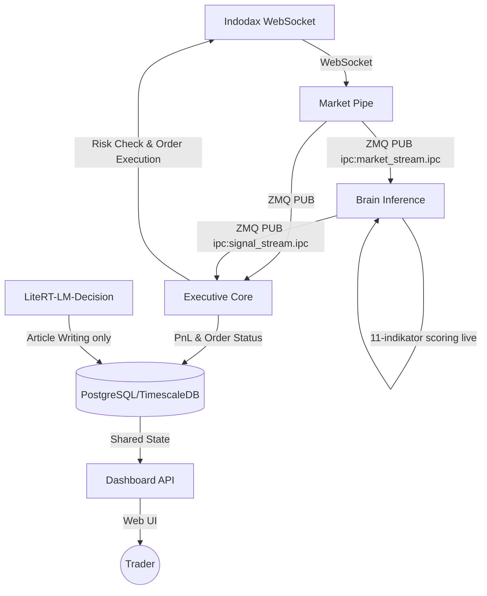

# Algovibe 🌊🤖

**Algovibe** adalah bot trading kripto otomatis (Scalping) untuk platform **Indodax** yang menggunakan arsitektur **Microservices**. Bot ini menggabungkan kecepatan eksekusi algoritma kuantitatif dengan analisis berbasis indikator teknikal murni untuk navigasi market yang presisi.

---

## 🎯 Fitur Utama

- **Microservice Architecture:** Terbagi menjadi 5 layanan independen (Market-Pipe, Brain-Inference, LiteRT-LM-Decision, Executive-Core, Dashboard-API) untuk skalabilitas dan stabilitas tinggi.
- **TECHNICAL_ONLY_MODE:** Semua keputusan trading 100% berbasis indikator teknikal (11 indikator, max score ~19.5). LLM hanya aktif untuk article writing.
- **Live Market Data:** Semua scoring dan sinyal menggunakan in-memory price history dari WebSocket stream — bukan data DB yang bisa stale.
- **Market Regime Detection:** Oracle sentral mendeteksi fase market (Bullish, Bearish, Choppy, Ranging, Crash) dan menyesuaikan strategi secara dinamis.
- **ZMQ-Driven Data Bus:** Komunikasi antar-layanan menggunakan ZeroMQ (IPC) untuk latency minimal.
- **Indodax Tax Compliant:** Kalkulasi PnL akurat termasuk pajak PMK 68/2022 (PPh & PPN) dan fee exchange.
- **Interactive Dashboard:** Monitoring realtime via Vue.js & SocketIO dengan visualisasi radar market dan eksekusi manual.
- **RF Auto-Trainer:** Background service yang secara otomatis melatih ulang model RandomForest (Scalper V2) berdasarkan data trade terbaru.

---

## 🔄 Workflow Arsitektur (Microservices)



---

## 🧠 Cara Kerja (Technical Engine)

Algovibe menggunakan sistem **Multi-Confluence Technical Scoring** dengan 11 indikator:

| # | Indikator | Bobot | Catatan |
|---|-----------|-------|---------|
| 1 | RSI-14 | 3.0 | Wilder smoothing |
| 2 | MACD Histogram | 2.5 | Price-normalized (x1000) |
| 3 | Bollinger %B | 2.0 | Posisi relatif band |
| 4 | Stochastic RSI | 2.0 | K/D + crossover |
| 5 | EMA 9/21 Crossover | 1.5 | Trend jangka menengah |
| 6 | Williams %R | 1.5 | Oversold/overbought independent |
| 7 | Slope/Momentum | 1.0 | Linear regression slope |
| 8 | ROC-10 | 1.0 | Rate of Change, mean-reversion |
| 9 | Order Book Pressure | 2.0 | Fallback ke Volume Ratio jika OB tidak ada |
| 10 | Volume Ratio | 1.5 | Vol sekarang / MA-20; spike = breakout valid |
| 11 | OBV Slope | 1.5 | Akumulasi/distribusi diam-diam |

Syarat BUY: `buy_score >= 6.0` dan `sell_score < 4.0`. Max score ~19.5.

### Entry Gate Sequence (`entry_gates.py`)

1. Open position / blacklist guard
2. Cooldown guard
3. Radar recommendation + tracking log
4. Multi-confluence technical gate (SELL block jika `sell_score >= 5.0`)
5. **ATR Volatility Filter (4b)** — reject jika ATR > 3% harga (4.5% di loose gates)
6. **EMA-50 Trend Filter (4c)** — reject jika harga < EMA-50 (dilewati di loose gates)
7. Technical probability + imbalance threshold
8. Trend / breakout requirement
9. Radar recommendation guard
10. Dynamic threshold based on volatility + trend
11. Consecutive-loss halt / Shadow Recovery
12. K-NN pattern scoring
13. Final confidence threshold

---

## ⚙️ Arsitektur Proyek

```
services/
├── market_pipe/        # Ingress: Indodax WS -> ZMQ Protobuf
├── brain_inference/    # Scoring & Oracle: live in-memory history, 11 indikator
├── litert_lm_decision/ # LLM: TECHNICAL_ONLY_MODE=true (article writing only)
├── executive_core/     # Execution: Risk Checks, P&L, Order Placement
└── dashboard_api/      # UI: Flask Server + SocketIO

app/
├── application/
│   ├── entry_gates.py          # Gerbang filter entry (11 gate + ATR + EMA50)
│   ├── use_cases/
│   │   ├── trade_execution.py  # BUY execution, fee-trap pure-% guard
│   │   └── candidate_enrichment.py
│   ├── oracle.py               # Market regime & K-NN pattern scoring
│   └── exit_manager.py         # TP/SL/Trailing; amount_idr tidak ditimpa saat reconcile
├── domain/
│   ├── technicals.py   # 11 indikator: RSI, MACD, BB, StochRSI, EMA, WilliamsR,
│   │                   # Slope, ROC, OB Pressure, Volume Ratio, OBV Slope
│   ├── scoring.py      # Radar scoring; terima price_history (live) sebagai arg ke-4
│   └── predictor.py    # ML model inference (Scalper V2, blend tech+ML)
└── infrastructure/
    ├── database.py     # PostgreSQL/TimescaleDB connector
    ├── ws_market.py    # WebSocket market stream + in-memory ticker/OB cache
    └── auto_trainer.py # Loop self-training model
```

---

## 🚀 Cara Menjalankan

### Docker (Rekomendasi - Production)

```bash
# 1. Setup Environment
cp .env-example .env
nano .env  # isi INDODAX_API_KEY dan INDODAX_API_SECRET

# 2. Jalankan Stack
docker compose up -d

# 3. Cek Status
docker compose ps
docker compose logs -f brain-inference executive-core
```

### Catatan Operasional Penting

- Jika ada perubahan di `.env` atau kode, lakukan restart/recreate yang sesuai:

```bash
# Setelah perubahan kode:
docker compose restart brain-inference executive-core

# Setelah perubahan env/config:
docker compose up -d --force-recreate brain-inference executive-core litert-lm-decision dashboard-api
```

- **TECHNICAL_ONLY_MODE = true** — LLM tidak akan membuat keputusan trading. Untuk mengaktifkan kembali LLM trading, set `technical_only_mode=false` di tabel `bot_state` DB dan ubah flag di `config.py`.
- `MIN_TRADE_IDR` (default: **10000**) — pastikan konsisten di semua container.
- Fee-trap guard menggunakan pure-percentage (0.5% dari nilai trade), bukan hard floor.
- `MICRO_PROFIT_EXIT` dievaluasi di harga `bid` (bukan `last`) dengan safety cushion.
- Cost basis (`amount_idr`) **tidak pernah** ditimpa saat reconcile — hanya `amount_crypto` yang disync dari exchange.

### Native (Development / Debugging)

```bash
python3 -m services.market_pipe.main     # Terminal 1
python3 -m services.brain_inference.main # Terminal 2
python3 -m services.executive_core.main  # Terminal 3
python3 -m services.litert_lm_decision.main # Terminal 4 (article writing only)
python3 -m dashboard.server              # Terminal 5
```

---

## 🎭 Market Regimes (Oracle)

Oracle mendeteksi kondisi pasar global dan menyesuaikan strategi secara dinamis:

| Regime | Deskripsi | Perilaku Bot |
| :--- | :--- | :--- |
| **BULLISH** | Tren naik, volume tinggi. | **Agresif**: Threshold diturunkan. |
| **BEARISH** | Tren turun, risiko tinggi. | **Defensif**: Filter diperketat. |
| **RANGING** | Harga sideways dalam range. | **Mean Reversion**: Fokus pada pullback. |
| **CHOPPY** | Sideways tajam/acak. | **Selective**: Cooldown diperpanjang. |
| **CRASH** | Penurunan tajam tak terkendali. | **Emergency Stop**: Berhenti otomatis. |

---

## ⚠️ Disclaimer

Software ini dibuat untuk tujuan edukasi dan eksperimen. **Gunakan dengan risiko Anda sendiri.** Pembuat tidak bertanggung jawab atas kerugian finansial. Selalu gunakan **DRY RUN** sebelum masuk ke live market.
