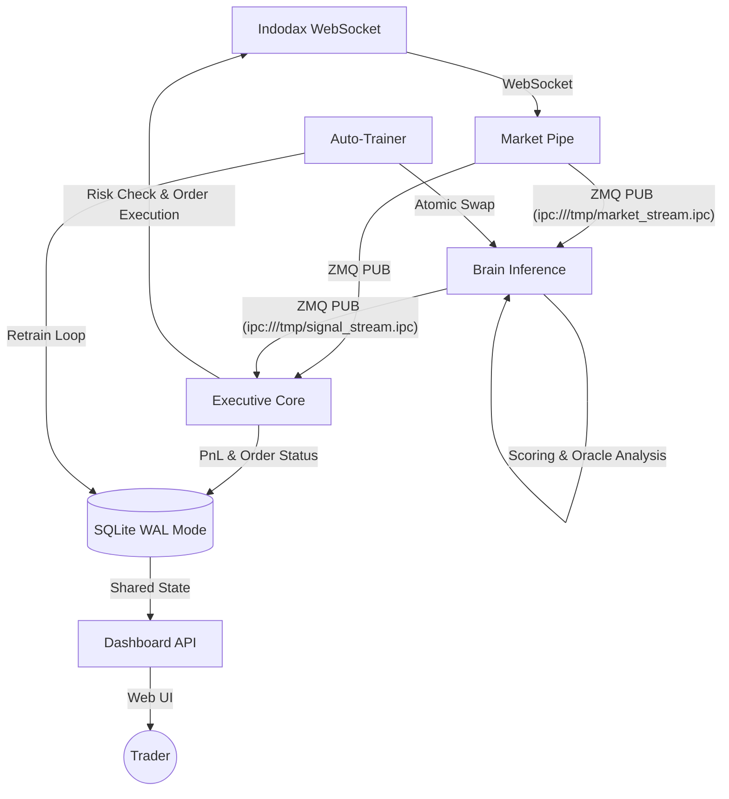

# Algovibe 🌊🤖

**Algovibe** adalah bot trading kripto otomatis (Scalping) untuk platform **Indodax** yang menggunakan arsitektur **Microservices**. Bot ini menggabungkan kecepatan eksekusi algoritma kuantitatif dengan kecerdasan kualitatif dari **AI Agent** (Gemma-4-E2B) untuk navigasi market yang presisi.

---

## 🎯 Fitur Utama

- **Microservice Architecture:** Terbagi menjadi 5 layanan independen (Market-Pipe, Brain-Inference, LiteRT-LM-Decision, Executive-Core, Dashboard-API) untuk skalabilitas dan stabilitas tinggi.
- **Autonomous AI Reasoning:** Terintegrasi dengan **LiteRT-LM** untuk analisis mikro-struktur pasar dan narasi teknikal otomatis.
- **Grounded LLM Exit Service:** Service `litert-lm-decision` membaca indikator teknikal, order book, fee round-trip, dan PnL lalu mengirim sinyal SELL terstruktur agar eksekusi tetap dilakukan ExitManager.
- **Market Regime Detection:** Oracle sentral yang mendeteksi fase market (Bullish, Bearish, Choppy) dan menyesuaikan strategi secara dinamis.
- **ZMQ-Driven Data Bus:** Komunikasi antar-layanan menggunakan ZeroMQ (IPC) untuk latency minimal.
- **Indodax Tax Compliant:** Kalkulasi PnL akurat yang sudah termasuk pajak PMK 68/2022 (PPh & PPN) dan fee exchange.
- **Interactive Dashboard:** Monitoring realtime via Vue.js & SocketIO dengan visualisasi radar market dan eksekusi manual.
- **RF Auto-Trainer:** Background service yang secara otomatis melatih ulang model RandomForest (Scalper V2) setiap jam berdasarkan data trade terbaru.

---

## 🔄 Workflow Arsitektur (Microservices)



---

## 🧠 Cara Kerja (Oracle & AI)

AlgoVibe tidak hanya mengandalkan indikator teknikal statis, melainkan menggunakan sistem **"Tiered Contextual Reasoning"**:

1.  **Oracle Contextualizer**: Mengumpulkan data dari 9 tier (VWAP, Orderbook Imbalance, Whale Prints, Momentum, dll) menjadi narasi yang kaya konteks.
2.  **AI Veto Power**: LLM melakukan penalaran pada prompt yang dikirim Oracle. AI dapat membatalkan (*veto*) sinyal teknikal jika mendeteksi anomali atau risiko tinggi.
3.  **Self-Learning Loop**: Setiap trade (Profit/Loss) dianalisis ulang melalui proses *Post-Mortem*. Hasilnya di-inject kembali ke memori jangka pendek bot ("Consciousness").
4.  **RF Auto-Trainer**: Model probabilistik (`scalper_v2.joblib`) dilatih ulang secara otomatis oleh `indodax-trainer.service`. Model hanya di-deploy jika accuracy lebih baik dari model sebelumnya, dengan *hot-reload* otomatis.

---

## ⚙️ Arsitektur Proyek

```
services/
├── market_pipe/        # Ingress: Indodax WS -> ZMQ Protobuf
├── brain_inference/    # Analysis: Technical Scoring, Oracle, AI Inference
├── litert_lm_decision/ # Grounded LiteRT-LM Exit Signal Publisher (SELL only)
├── executive_core/     # Execution: Risk Checks, P&L, Order Placement
└── dashboard_api/      # UI: Flask Server + SocketIO

app/
├── application/
│   ├── entry_gates.py  # Gerbang filter entry (Technical + K-NN)
│   ├── oracle.py       # Kecerdasan market regime & AI
│   └── exit_manager.py # Pengelola keluar posisi (TP/SL/Trailing)
├── domain/
│   ├── predictor.py    # ML model inference (Scalper V2)
│   └── technicals.py   # Rumus indikator (RSI, MACD, dll)
└── infrastructure/
    ├── database.py     # SQLite Router (Live/Dry/Audit)
    └── auto_trainer.py # Loop self-training otomatis
```

---

## 🚀 Cara Menjalankan

### Docker (Rekomendasi - Production)

Gunakan Docker Compose untuk menjalankan seluruh stack microservice:

```bash
# 1. Setup Environment
cp .env-example .env
nano .env

# 2. Jalankan Stack
docker compose up -d

# 3. Cek Status
docker compose ps
docker compose logs -f brain-inference
```

### Native (Development)

Jika ingin menjalankan service secara manual untuk debugging:

```bash
# Terminal 1: Market Pipe
python3 -m services.market_pipe.main

# Terminal 2: Brain Inference
python3 -m services.brain_inference.main

# Terminal 3: Executive Core
python3 -m services.executive_core.main

# Terminal 4: LiteRT-LM Decision Service
python3 -m services.litert_lm_decision.main

# Terminal 5: Dashboard
python3 -m dashboard.server
```

---

## 🎭 Kecerdasan Oracle: Market Regimes

Oracle mendeteksi kondisi pasar global dan mengubah perilaku bot secara dinamis:

| Regime | Deskripsi | Perilaku Bot |
| :--- | :--- | :--- |
| **BULLISH** | Tren naik, volume tinggi. | **Agresif**: Threshold diturunkan. |
| **BEARISH** | Tren turun, risiko tinggi. | **Defensif**: Filter diperketat. |
| **RANGING** | Harga sideways dalam range. | **Mean Reversion**: Fokus pada pullback. |
| **CHOPPY** | Sideways tajam/acak. | **Selective**: Cooldown diperpanjang. |
| **CRASH** | Penurunan tajam tak terkendali. | **Emergency Stop**: Berhenti otomatis. |

---

## ⚠️ Disclaimer

Software ini dibuat untuk tujuan edukasi dan eksperimen. **Gunakan dengan risiko Anda sendiri.** Pembuat tidak bertanggung jawab atas kerugian finansial. Selalu gunakan **DRY RUN** sebelum masuk ke live market.
