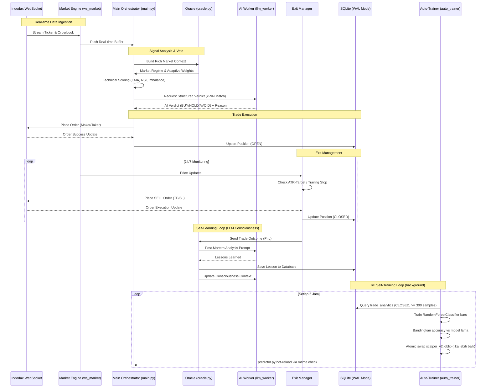

# Algovibe 🌊🤖

**Algovibe** adalah bot trading kripto otomatis (Scalping) untuk platform **Indodax** yang diciptakan melalui proses **"Vibe Coding"**. Bot ini menggabungkan kecepatan eksekusi algoritma kuantitatif dengan kecerdasan kualitatif dari **AI Agent** (Gemma-4-E2B) untuk navigasi market yang presisi.

---

## 🎯 Fitur Utama

- **Autonomous AI Reasoning:** Terintegrasi dengan **LiteRT-LM** untuk analisis mikro-struktur pasar dan narasi teknikal otomatis.
- **Market Regime Detection:** Oracle sentral yang mendeteksi fase market (Bullish, Bearish, Choppy) dan menyesuaikan strategi secara dinamis.
- **High-Concurrency Engine:** Arsitektur *multiprocessing* Python dengan SQLite WAL mode untuk performa tinggi tanpa jeda.
- **Indodax Tax Compliant:** Kalkulasi PnL akurat yang sudah termasuk pajak PMK 68/2022 (PPh & PPN) dan fee exchange.
- **Interactive Dashboard:** Monitoring realtime via Flask & SocketIO dengan visualisasi radar market dan eksekusi manual.
- **Dry Run Mode:** Simulasi trading tanpa risiko finansial untuk validasi strategi.
- **Docker-First Deployment:** Container image siap pakai dengan health check, graceful shutdown, dan HTTP auth registry.
- **RF Auto-Trainer:** Background service yang secara otomatis melatih ulang model RandomForest (Scalper V2) setiap 6 jam berdasarkan data trade terbaru, dengan atomic model swap dan hot-reload tanpa restart bot.

---

## 🔄 Workflow Arsitektur (End-to-End)



---

## 🧠 Cara Kerja (Oracle & AI)

AlgoVibe tidak hanya mengandalkan indikator teknikal statis, melainkan menggunakan sistem **"Tiered Contextual Reasoning"**:

1.  **Oracle Contextualizer**: Mengumpulkan data dari 9 tier (VWAP, Orderbook Imbalance, Whale Prints, Momentum, dll) menjadi narasi yang kaya konteks.
2.  **AI Veto Power**: LLM melakukan penalaran pada prompt yang dikirim Oracle. AI dapat membatalkan (*veto*) sinyal teknikal jika mendeteksi anomali atau risiko tinggi.
3.  **Self-Learning Loop (LLM)**: Setiap trade (Profit/Loss) dianalisis ulang melalui proses *Post-Mortem*. Hasilnya di-inject kembali ke memori jangka pendek bot ("Consciousness") setiap 30 menit.
4.  **RF Auto-Trainer**: Model probabilistik (`scalper_v2.joblib`) dilatih ulang secara otomatis oleh `indodax-trainer.service` setiap 6 jam. Model hanya di-deploy jika accuracy lebih baik dari model sebelumnya, tanpa perlu restart bot (hot-reload via mtime check).

---

## ⚙️ Arsitektur Proyek

```
app/
├── bootstrap.py              # Composition root — wiring semua dependency
├── application/
│   ├── scalper_bot.py        # Orchestrator utama bot
│   ├── exit_manager.py       # Monitoring posisi & eksekusi exit (TP/SL/DCA)
│   ├── oracle.py             # Market regime, AI reasoning, self-learning
│   └── use_cases/
│       ├── market_cycle.py   # Loop utama per siklus market
│       ├── pair_pipeline.py  # Kandidat pair: build & process
│       ├── entry_gates.py    # Semua gate pre-entry (AI, K-NN, LLM)
│       ├── entry_targeting.py# ATR-based dynamic TP/SL calculation
│       ├── entry_dispatch.py # Final trade execution trigger
│       └── candidate_enrichment.py
├── domain/
│   ├── predictor.py          # ML model inference (scikit-learn)
│   ├── scoring.py            # Volatility-adjusted momentum scoring
│   └── technicals.py        # EMA, RSI, ATR, orderbook analysis
└── infrastructure/
    ├── database.py           # SQLite WAL schema & queries
    ├── ws_market.py          # Indodax Market WebSocket
    ├── ws_private.py         # Indodax Private WebSocket (order updates)
    ├── llm_worker.py         # LiteRT-LM background process + queue
    ├── auto_trainer.py       # RF self-training loop (indodax-trainer.service)
    ├── exchange_factory.py   # CCXT Indodax client
    └── deadman.py            # Deadman switch safety monitor
dashboard/server.py           # Flask + SocketIO dashboard (port 8080)
```

---

## 🚀 Instalasi Cepat

1. **Setup Venv & Dependencies:**
   ```bash
   python3 -m venv venv
   source venv/bin/activate
   pip install -r requirements.txt
   ```

2. **Environment Configuration:**
   Buat file `.env` di root direktori:
   ```env
   INDODAX_API_KEY="your_api_key"
   INDODAX_API_SECRET="your_secret_key"
   SECRET_KEY="random_hex_64_chars"        # Wajib — keamanan dashboard session
   TELEGRAM_BOT_TOKEN="your_token"         # Opsional — notifikasi Telegram
   MIN_TRADE_IDR=11000                     # Opsional — override minimum order IDR
   ```

3. **Generate SECRET_KEY:**
   ```bash
   python3 -c "import secrets; print(secrets.token_hex(32))"
   ```

4. **Risk Management:**
   Atur target TP/SL dan batasan capital di `config.py`.

---

## 🤖 Integrasi LiteRT-LM (AI Engine)

AlgoVibe menggunakan **LiteRT-LM** (sebelumnya TensorFlow Lite) untuk menjalankan model bahasa besar secara lokal di CPU tanpa memerlukan GPU eksternal atau API pihak ketiga.

### Spek Model & Optimasi
- **Model**: Gemma-4-E2B (Gemma-2B tuned untuk efisiensi eksekusi).
- **Format**: `.litertlm` (optimized flatbuffers).
- **Akselerasi**: Menggunakan **XNNPACK** CPU acceleration dengan *model caching* (~750MB) untuk memastikan *latency* inferensi tetap rendah di lingkungan server.

### Arsitektur AI Worker
Untuk menjaga stabilitas eksekusi trading, AI berjalan di **Background Process** terpisah:
1.  **Asynchronous Queuing**: Main bot mengirim tugas ke `llm_worker` melalui `multiprocessing.Queue`. Ini memastikan pergerakan harga *real-time* tidak pernah terhambat oleh proses "berpikir" AI.
2.  **Function Calling (Structured Output)**: Bot tidak menggunakan parsing teks biasa yang rawan error. LLM menggunakan fitur *function calling* untuk memanggil fungsi `submit_verdict()`, menghasilkan output JSON yang valid secara konsisten.
3.  **Context Injection**: Setiap kali AI dipanggil, Oracle menyuntikkan data pasar terbaru, *lessons learned* dari trade sebelumnya, dan *market regime* saat ini ke dalam memori jangka pendek AI.

---

## 🎭 Kecerdasan Oracle: Market Regimes

Oracle adalah "pusat kesadaran" AlgoVibe yang memastikan bot tidak hanya sekadar *blind-trading*. Oracle mendeteksi kondisi pasar global dan mengubah perilaku bot secara dinamis melalui **Adaptive Configuration**.

| Regime | Deskripsi | Perilaku Bot | Alokasi Modal |
| :--- | :--- | :--- | :--- |
| **BULLISH** | Harga didominasi tren naik, volume tinggi. | **Agresif**: Ambang batas AI diturunkan, lebih banyak sinyal diloloskan. | **1.5x (Aggressive)** |
| **BEARISH** | Harga didominasi tren turun, risiko tinggi. | **Defensif**: Filter AI diperketat, hanya koin volume besar yang diambil. | **0.6x (Conservative)** |
| **RANGING** | Harga bergerak menyamping dalam range tertentu. | **Mean Reversion**: Fokus pada *imbalance* orderbook dan *pullback* EMA. | **1.2x (Optimized)** |
| **CHOPPY** | Pergerakan tidak menentu (sideways tajam). | **Selective**: Menunggu momentum yang benar-benar valid, *cooldown* diperpanjang. | **0.9x (Cautious)** |
| **CRASH** | Penurunan tajam yang tidak terkendali. | **Emergency Stop**: Bot berhenti trading secara otomatis untuk menjaga modal. | **0.0x (OFF)** |

### Penyesuaian Bobot Dinamis
Oracle secara otomatis mengubah bobot strategi (`weights`) berdasarkan rezim:
- **Imbalance Weight**: Ditingkatkan saat pasar *Bearish* karena mikrostruktur *orderbook* lebih jujur daripada tren harga.
- **Sentiment Weight**: Ditingkatkan saat pasar *Bullish* untuk mengejar koin-koin narasi/sektor yang sedang *hot*.
- **Veto Confidence**: AI menjadi lebih sensitif untuk membatalkan trade saat kondisi pasar tidak menentu (*Choppy*).

---

## ⚖️ Logika Pengambilan Keputusan

AlgoVibe menggunakan sistem hibrida antara matematika kuantitatif dan penalaran kualitatif AI untuk menentukan kapan harus masuk dan keluar market.

### 🟢 Strategi BUY (Entry)
1.  **Smart Scan**: Bot mengurutkan ratusan koin berdasarkan *Volatility-Adjusted Momentum*. Hanya koin "hidup" yang masuk ke radar.
2.  **Technical Filter**: Menggunakan kombinasi EMA Cross (EMA-20 > EMA-50) dan strategi **Pullback Entry** (beli saat harga retrace ke support EMA).
3.  **Microstructure Check**: Mengecek *Orderbook Imbalance*. Bot hanya masuk jika ada dominasi "tembok beli" (bid) yang kuat.
4.  **AI Pattern Matching (k-NN)**: Bot membandingkan pola harga saat ini dengan ribuan transaksi historis di database. Jika pola tersebut memiliki *win rate* rendah di masa lalu, AI akan melakukan **Veto**.
5.  **Execution Intelligence:** Semua entry menggunakan **Taker (Market Order)** untuk eksekusi instan tanpa antre. Harga beli mengacu pada snapshot realtime ticker saat sinyal terpenuhi.

### 📐 Verifikasi Kuantitatif: Estimasi Waktu (ETA)
AlgoVibe tidak hanya menebak target harga, tetapi juga mengestimasi **kapan** target tersebut akan tercapai. Sistem menggunakan model hibrida:
-   **Math Engine (Price Velocity)**: Bot menghitung rata-rata pergerakan harga absolut per menit ($V_{ema}$) secara *real-time*. Estimasi waktu dihitung dengan: $ETA = \text{Jarak Harga} / V_{ema}$.
-   **AI Intuition**: LiteRT-LM memberikan estimasi waktu berdasarkan sentimen dan pola historis.
-   **Calibration**: Sistem menggabungkan kedua angka tersebut (60% Math, 40% AI) untuk memberikan estimasi ETA yang realistis di Dashboard.

### 🔴 Strategi SELL (Exit)
1.  **ATR-Based Dynamic Take Profit**: Target profit dihitung berdasarkan volatilitas ATR 1 menit, dimodifikasi oleh faktor conviction (probabilitas AI × kepercayaan LLM), RSI exhaustion, dan orderbook pressure. Range dinamis **0.84% — 15%**, dengan minimum risk-to-reward 1:1.2.
2.  **Trailing Stop Loss**: Mengunci profit secara otomatis saat harga naik. Jarak trailing adaptif — semakin besar profit, semakin ketat jaraknya (0.4% di profit normal, 0.2% di profit > 4%).
3.  **Break-Even Stop**: Saat profit menyentuh 1%, SL otomatis dipindahkan ke harga entry + fee (trade bebas risiko).
4.  **Tiered Rapid Exit**: Profit bagus (≥ Rp 7.500 atau ≥ 1.5%) langsung keluar jika ada tanda momentum melemah (RSI > 72, AI fade, atau SELL signal). Profit tinggi (≥ Rp 15.000 atau ≥ 4.5%) di-force exit instan.
5.  **Time-Stop**: Posisi yang tidak bergerak lebih dari `MAX_HOLD_MINUTES` (default 10 menit) ditutup otomatis.
6.  **Protective Stop Loss**: SL awal berbasis ATR, capped antara **0.7% — 3.5%** dari harga entry.
7.  **Oracle Emergency Exit**: AI Oracle dapat memerintahkan bot menjual lebih awal jika mendeteksi perubahan rezim market menjadi **Bearish** atau **Crash** secara mendadak.
8.  **Strategic DCA (Averaging Down)**: Sebelum cut-loss, bot dapat menambah muatan hingga 2 tier jika AI masih optimis (confidence > 35%), dengan harga rata-rata baru yang dihitung ulang.

---

## 🛠 Deployment

### Docker (Recommended — Production)

```bash
# Build dan push ke private registry
REGISTRY_PASS=xxx ./build_and_push.sh

# Deploy ke server (pull + restart + health check)
REGISTRY_PASS=xxx ./deploy_sync.sh
```

Container berjalan sebagai non-root user, `read_only` filesystem, dengan `tmpfs` untuk `/tmp` dan `models/cache`. Data bot di-persist via volume `./data:/app/data`.

### Native (Development)

```bash
# Bot engine
python3 main.py

# Dashboard (terminal terpisah)
python3 dashboard/server.py
```

### Systemd (Native 24/7)

```bash
systemctl --user start indodax-scalper.service
systemctl --user start indodax-dashboard.service
systemctl --user start indodax-trainer.service   # RF auto-trainer (background)
```

#### RF Auto-Trainer

Service `indodax-trainer.service` berjalan terpisah dari bot utama. Setiap 6 jam, trainer akan:
1. Query `trade_analytics` dari `algotrade.db` (sliding window 5.000 trade terakhir)
2. Validasi minimal **300 closed trades** — jika belum cukup, skip dan tidur
3. Train `RandomForestClassifier` baru
4. Deploy hanya jika accuracy baru ≥ model lama + 1% **dan** ≥ 55% floor
5. Atomic swap file (`scalper_v2.joblib.tmp` → `scalper_v2.joblib`)
6. Bot utama **hot-reload** model otomatis di predict berikutnya tanpa restart

Konfigurasi di `config.py`:
```python
AUTO_TRAIN_ENABLED        = True
AUTO_TRAIN_INTERVAL_HOURS = 6      # Interval training
AUTO_TRAIN_MIN_SAMPLES    = 300    # Minimal closed trades
AUTO_TRAIN_MIN_ACCURACY   = 0.55   # Floor accuracy
AUTO_TRAIN_MIN_DELTA      = 0.01   # Delta minimum vs model lama
```

Log trainer tersedia di: `data/logs/auto_trainer.log`

---

## ⚠️ Disclaimer

Software ini dibuat untuk tujuan edukasi dan eksperimen. **Gunakan dengan risiko Anda sendiri.** Pembuat tidak bertanggung jawab atas kerugian finansial. Selalu gunakan **DRY RUN** sebelum masuk ke live market.
