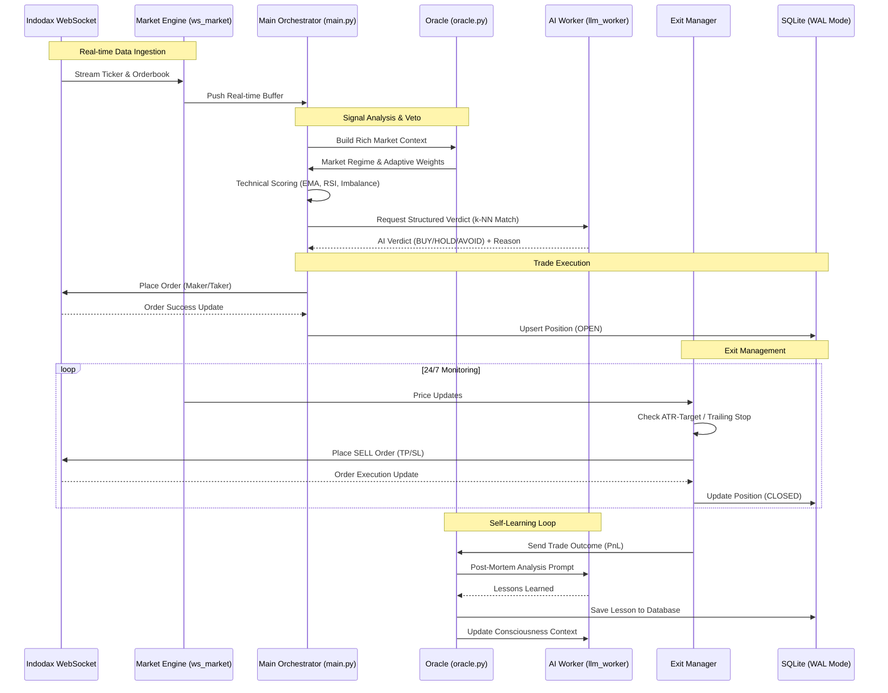

# Algovibe 🌊🤖

**Algovibe** adalah bot trading kripto otomatis (Scalping) untuk platform **Indodax** yang diciptakan melalui proses **"Vibe Coding"**. Bot ini menggabungkan kecepatan eksekusi algoritma kuantitatif dengan kecerdasan kualitatif dari **AI Agent** (Gemma-4-E2B) untuk navigasi market yang presisi.

---

## 🎯 Fitur Utama

- **Autonomous AI Reasoning:** Terintegrasi dengan **LiteRT-LM** untuk analisis mikro-struktur pasar dan narasi teknikal otomatis.
- **Market Regime Detection:** Oracle sentral yang mendeteksi fase market (Bullish, Bearish, Choppy) dan menyesuaikan strategi secara dinamis.
- **High-Concurrency Engine:** Arsitektur *multiprocessing* Python dengan SQLite WAL mode untuk performa tinggi tanpa jeda.
- **Indodax Tax Compliant:** Kalkulasi PnL akurat yang sudah termasuk pajak PMK 68/2022 (PPh & PPN) dan fee exchange.
- **Interactive Dashboard:** Monitoring realtime via Flask & SocketIO dengan visualisasi radar market dan eksekusi manual.
- **Dry Run Mode:** Simulasi trading tanpa risiko finansial untuk validasi strategi.

---

## 🔄 Workflow Arsitektur (End-to-End)



---

## 🧠 Cara Kerja (Oracle & AI)

AlgoVibe tidak hanya mengandalkan indikator teknikal statis, melainkan menggunakan sistem **"Tiered Contextual Reasoning"**:

1.  **Oracle Contextualizer**: Mengumpulkan data dari 9 tier (VWAP, Orderbook Imbalance, Whale Prints, Momentum, dll) menjadi narasi yang kaya konteks.
2.  **AI Veto Power**: LLM melakukan penalaran pada prompt yang dikirim Oracle. AI dapat membatalkan (*veto*) sinyal teknikal jika mendeteksi anomali atau risiko tinggi.
3.  **Self-Learning Loop**: Setiap trade (Profit/Loss) dianalisis ulang melalui proses *Post-Mortem*. Hasilnya di-inject kembali ke memori jangka pendek bot ("Consciousness") setiap 30 menit.

---

## ⚙️ Arsitektur Proyek

- `main.py`: Orkestrator utama dan lifecycle bot.
- `engines/oracle.py`: Mesin kecerdasan sentral (Regime & Context).
- `engines/llm_worker.py`: Background worker untuk inferensi LiteRT-LM.
- `engines/ws_market.py` & `ws_private.py`: Handler WebSocket untuk data pasar dan update order.
- `engines/exit_manager.py`: Manajemen posisi terbuka dan eksekusi TP/SL.
- `engines/database.py`: Layer persistensi data stateful (SQLite WAL).
- `engines/technicals.py`: Indikator teknikal (RSI, EMA, Volatility).
- `engines/predictor.py`: Logika prediksi harga berbasis k-NN.

---

## 🚀 Instalasi Cepat

1. **Setup Venv & Dependencies:**
   ```bash
   python3 -m venv venv
   source venv/bin/activate
   pip install -r requirements.txt
   ```

2. **Environment Configuration:**
   Buat file `.env` di root direktori:
   ```env
   INDODAX_API_KEY="your_api_key"
   INDODAX_API_SECRET="your_secret_key"
   ```

3. **Risk Management:**
   Atur target TP/SL dan batasan capital di `config.py`.

---

## 🤖 Integrasi LiteRT-LM (AI Engine)

AlgoVibe menggunakan **LiteRT-LM** (sebelumnya TensorFlow Lite) untuk menjalankan model bahasa besar secara lokal di CPU tanpa memerlukan GPU eksternal atau API pihak ketiga.

### Spek Model & Optimasi
- **Model**: Gemma-4-E2B (Gemma-2B tuned untuk efisiensi eksekusi).
- **Format**: `.litertlm` (optimized flatbuffers).
- **Akselerasi**: Menggunakan **XNNPACK** CPU acceleration dengan *model caching* (~750MB) untuk memastikan *latency* inferensi tetap rendah di lingkungan server.

### Arsitektur AI Worker
Untuk menjaga stabilitas eksekusi trading, AI berjalan di **Background Process** terpisah:
1.  **Asynchronous Queuing**: Main bot mengirim tugas ke `llm_worker` melalui `multiprocessing.Queue`. Ini memastikan pergerakan harga *real-time* tidak pernah terhambat oleh proses "berpikir" AI.
2.  **Function Calling (Structured Output)**: Bot tidak menggunakan parsing teks biasa yang rawan error. LLM menggunakan fitur *function calling* untuk memanggil fungsi `submit_verdict()`, menghasilkan output JSON yang valid secara konsisten.
3.  **Context Injection**: Setiap kali AI dipanggil, Oracle menyuntikkan data pasar terbaru, *lessons learned* dari trade sebelumnya, dan *market regime* saat ini ke dalam memori jangka pendek AI.

---

## 🎭 Kecerdasan Oracle: Market Regimes

Oracle adalah "pusat kesadaran" AlgoVibe yang memastikan bot tidak hanya sekadar *blind-trading*. Oracle mendeteksi kondisi pasar global dan mengubah perilaku bot secara dinamis melalui **Adaptive Configuration**.

| Regime | Deskripsi | Perilaku Bot | Alokasi Modal |
| :--- | :--- | :--- | :--- |
| **BULLISH** | Harga didominasi tren naik, volume tinggi. | **Agresif**: Ambang batas AI diturunkan, lebih banyak sinyal diloloskan. | **1.5x (Aggressive)** |
| **BEARISH** | Harga didominasi tren turun, risiko tinggi. | **Defensif**: Filter AI diperketat, hanya koin volume besar yang diambil. | **0.6x (Conservative)** |
| **RANGING** | Harga bergerak menyamping dalam range tertentu. | **Mean Reversion**: Fokus pada *imbalance* orderbook dan *pullback* EMA. | **1.2x (Optimized)** |
| **CHOPPY** | Pergerakan tidak menentu (sideways tajam). | **Selective**: Menunggu momentum yang benar-benar valid, *cooldown* diperpanjang. | **0.9x (Cautious)** |
| **CRASH** | Penurunan tajam yang tidak terkendali. | **Emergency Stop**: Bot berhenti trading secara otomatis untuk menjaga modal. | **0.0x (OFF)** |

### Penyesuaian Bobot Dinamis
Oracle secara otomatis mengubah bobot strategi (`weights`) berdasarkan rezim:
- **Imbalance Weight**: Ditingkatkan saat pasar *Bearish* karena mikrostruktur *orderbook* lebih jujur daripada tren harga.
- **Sentiment Weight**: Ditingkatkan saat pasar *Bullish* untuk mengejar koin-koin narasi/sektor yang sedang *hot*.
- **Veto Confidence**: AI menjadi lebih sensitif untuk membatalkan trade saat kondisi pasar tidak menentu (*Choppy*).

---

## ⚖️ Logika Pengambilan Keputusan

AlgoVibe menggunakan sistem hibrida antara matematika kuantitatif dan penalaran kualitatif AI untuk menentukan kapan harus masuk dan keluar market.

### 🟢 Strategi BUY (Entry)
1.  **Smart Scan**: Bot mengurutkan ratusan koin berdasarkan *Volatility-Adjusted Momentum*. Hanya koin "hidup" yang masuk ke radar.
2.  **Technical Filter**: Menggunakan kombinasi EMA Cross (EMA-20 > EMA-50) dan strategi **Pullback Entry** (beli saat harga retrace ke support EMA).
3.  **Microstructure Check**: Mengecek *Orderbook Imbalance*. Bot hanya masuk jika ada dominasi "tembok beli" (bid) yang kuat.
4.  **AI Pattern Matching (k-NN)**: Bot membandingkan pola harga saat ini dengan ribuan transaksi historis di database. Jika pola tersebut memiliki *win rate* rendah di masa lalu, AI akan melakukan **Veto**.
5.  **Execution Intelligence**: Bot secara otomatis memilih antara **Maker Order** (antri di EMA-9 untuk hemat fee) atau **Taker Order** (langsung hajar market jika momentum sangat kuat).

### 🔴 Strategi SELL (Exit)
1.  **ATR-Based Take Profit**: Target profit tidak statis, melainkan dihitung berdasarkan volatilitas ATR (*Average True Range*). Target dinamis antara 2% hingga 12%.
2.  **Trailing Stop Loss**: Mengunci profit secara otomatis saat harga naik. Bot akan terus "mengikuti" harga ke atas dan hanya menjual jika harga berbalik turun sebesar jarak tertentu.
3.  **Protective Stop Loss**: Batas rugi maksimal (biasanya 3.5% - 6%) untuk mencegah kerugian besar saat terjadi *flash crash*.
4.  **Oracle Emergency Exit**: AI Oracle dapat memerintahkan bot untuk menjual posisi lebih awal jika mendeteksi perubahan rezim market menjadi **Bearish** atau **Crash** secara mendadak.

---

## 🛠 Deployment (Systemd)

Jalankan bot sebagai service agar tetap aktif 24/7 di background.

**Bot Engine (`indodax-scalper.service`):**
```ini
[Service]
WorkingDirectory=/root/algovibe
ExecStart=/root/algovibe/venv/bin/python /root/algovibe/main.py
Restart=always
```

**Dashboard (`indodax-dashboard.service`):**
```ini
[Service]
WorkingDirectory=/root/algovibe
ExecStart=/root/algovibe/venv/bin/python /root/algovibe/dashboard/server.py
Restart=always
```

---

## ⚠️ Disclaimer

Software ini dibuat untuk tujuan edukasi dan eksperimen. **Gunakan dengan risiko Anda sendiri.** Pembuat tidak bertanggung jawab atas kerugian finansial. Selalu gunakan **DRY RUN** sebelum masuk ke live market.
