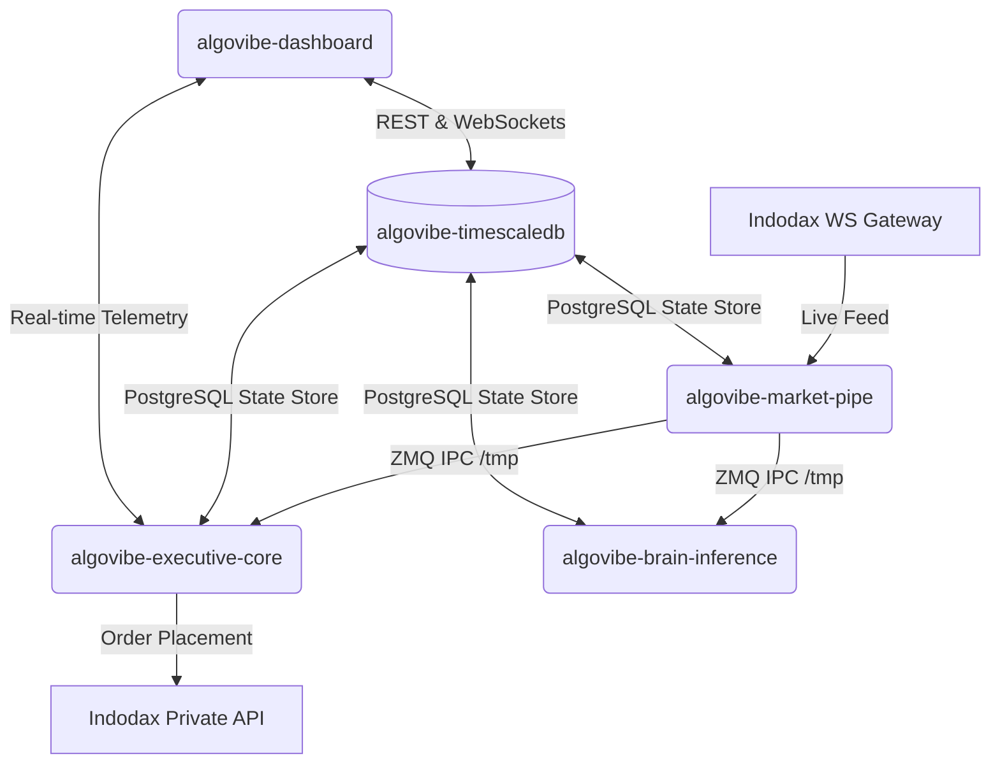

# AlgoVibe Installation & Operation Guide

This guide provides step-by-step instructions for deploying and operating the **AlgoVibe** crypto scalping bot on a fresh machine. With the newly introduced `install.sh` orchestrator, setup and database schema migrations are fully automated.

---

## 🏛️ Microservice Architecture Map

AlgoVibe is built as a high-frequency, low-latency microservice stack:



- **`timescaledb`**: Database storage for live/dry-run states and transaction records.
- **`model-downloader`**: Lightweight init container that validates and pulls the 2.5GB AI Model.
- **`market-pipe`**: WebSocket client running in **Host Network Mode** to minimize latency, publishing normalized Protobuf streams via ZeroMQ IPC.
- **`executive-core`**: High-priority container executing technical strategy limits, risk controls, and automated exits.
- **`brain-inference`**: Feeds technical indicator streams into the XGBoost classification model.
- **`news-maker`**: Synthesizes market news using local Gemma weights or cloud LLM endpoints.
- **`dashboard-api`**: Flask & SocketIO application serving the user interface on port `8080`.

---

## 📋 Prerequisites

Ensure your host machine meets the following minimal requirements:
- **Operating System**: Linux (Ubuntu 20.04+ recommended)
- **Docker**: Engine version `24.0.0` or higher
- **Docker Compose**: CLI plugin v2 (runs via `docker compose`, not the legacy `docker-compose`)

---

## 🚀 Quick Start (Fresh Machine Installation)

Deploying AlgoVibe on a new system is completely automated. Run the following command sequence:

### 1) Clone & Prepare Repository
```bash
git clone <repository_url> algovibe
cd algovibe
```

### 2) Execute the Installer
The installer verifies dependencies, sets up configuration files, builds networks, and orchestrates database setup/migrations automatically:

```bash
# Standard Development Mode (Highly Recommended)
./install.sh --dev

# Production Mode
./install.sh --prod
```

---

## ⚙️ How the Automated Setup Works

Under the hood, `install.sh` performs the following safety-first orchestration steps:

1. **Dependency Verification**: Confirms Docker Daemon and Compose CLI are installed and accessible.
2. **Environment Protection**: Instantiates `.env` from `.env-example` if missing without overwriting existing settings.
3. **External Network Creation**: Checks for and creates the external `npm_default` network namespace required for production load-balancers/reverse proxies.
4. **Build Frontend Dashboard Assets**: Runs a temporary, isolated Node.js container to compile static web assets (Vite+Vue) directly into `dashboard/static/dist` without requiring Node/NPM to be installed on the host machine:
   ```bash
   docker run --rm -v "$(pwd)/dashboard/frontend:/app" -v "$(pwd)/dashboard/static:/static" -w /app node:20-alpine sh -c "npm install && npm run build"
   ```
5. **Database Boot & Health Check**: Starts `timescaledb` first and polls its internal health status until Postgres is fully initialized and ready on port `5432`.
6. **Sequential Alembic Migrations**: Launches a temporary, isolated container to run schema migrations:
   ```bash
   docker compose -f docker-compose-dev.yml run --rm executive-core python3 -m app.infrastructure.migrations
   ```
   *This guarantees that all tables (such as `bot_state` and `positions`) exist before any live code tries to fetch or write parameters.*
7. **Orderly Microservices Launch**: Spins up all remaining services. `market-pipe` has robust ready-checks that gracefully wait for database tables to appear before subscribing to Indodax trade streams.

---

## 🔧 Environment Configuration (`.env`)

Before running live trading campaigns, open and configure the `.env` file with your credentials:

```ini
# Indodax API Credentials
INDODAX_API_KEY=your_api_key_here
INDODAX_API_SECRET=your_api_secret_secret

# Mode Configuration (DRY_RUN=True activates simulation mode)
DRY_RUN=True

# Bot Constants
TELEGRAM_BOT_TOKEN=your_telegram_bot_token
TELEGRAM_CHAT_ID=your_telegram_chat_id
```

> [!WARNING]
> Keep `DRY_RUN=True` active during initialization to verify strategy parameters and dashboard telemetry without risking capital.

---

## 🛠️ Operations & Maintenance Manual

### Container Status & Health Verification
Confirm all containers are healthy:
```bash
docker compose -f docker-compose-dev.yml ps
```

### Accessing Live Logs
To stream logs from all microservices, run:
```bash
docker compose -f docker-compose-dev.yml logs -f
```

To tail logs for a specific service:
```bash
# Ingress WS stream logs
docker compose -f docker-compose-dev.yml logs -f market-pipe

# Strategy Engine and Exit limits
docker compose -f docker-compose-dev.yml logs -f executive-core
```

### Shutting Down the Stack
To gracefully stop all services and preserve volumes:
```bash
docker compose -f docker-compose-dev.yml down
```

To tear down containers AND completely wipe databases for a fresh reset:
```bash
docker compose -f docker-compose-dev.yml down -v
```

---

## 🔍 Deep Dive: Network Mode Host

To minimize networking latency on the market WebSocket ingress, the `market-pipe` service uses `network_mode: host` in `docker-compose.yml` and `docker-compose-dev.yml`. 

> [!NOTE]
> - Since `market-pipe` shares the host namespace, it connects to Postgres via **`localhost:5432`** rather than the internal Docker DNS name `timescaledb:5432`.
> - Ensure no other service on your host machine is actively binding to port `5432` to avoid container initialization failures.
---

## 💾 Moving Data to a New Server

Algovibe dirancang agar mudah dipindahkan antar VPS. Ada dua jenis data yang perlu diperhatikan:

### 1. Strategi & Profil (Otomatis)
Semua strategi (`jokobodo`, `anglingdharma`, dkk) dapat dipindahkan menggunakan file `seed_data.sql`.
- Bot akan otomatis mengeksekusi file ini jika database baru masih kosong.
- File ini dihasilkan otomatis oleh bot atau bisa dibuat manual via `pg_dump`.

### 2. Data History 90 Hari (Manual)
Karena ukurannya yang besar (GB), data OHLCV harus dipindahkan secara manual menggunakan skrip utilitas:

**Di Server Lama:**
```bash
./migrate_history.sh export
# Ini akan menghasilkan file ohlcv_90d_dump.sql.gz
```

**Di Server Baru:**
1. Pindahkan file `ohlcv_90d_dump.sql.gz` ke server baru.
2. Jalankan impor:
```bash
./migrate_history.sh import
```

---
